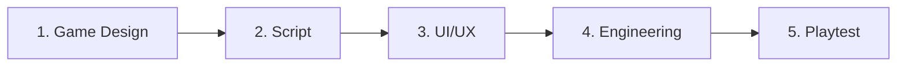

# ESC KEY 역할 핸드오프

기준 문서: `docs/개발/공통엔진_v1.md`. Unity 웹 템플릿은 폐기. 구현·기획이 이 문서와 다르면 문서가 이긴다.

모바일 웹, 터치만. PC는 개발 확인용. 가로 전용. 입장 때 자동 전체화면 없음. 모바일은 게이트에서 물은 뒤 동의 시에만. PC는 HUD 최대 모드 버튼. 테마는 장면·퍼즐·대사·연출 데이터만 만든다.

## 역할

### Game Designer
세계관, 퍼즐, 30/60분 타임박스, 힌트 3단계, 타이머 스킨, 엔딩 조건, 권한 거부 대체 경로.
산출: 테마 설계 문서. 엔진에 실을 때는 `ThemeDefinition` (공통엔진 §13).

### Scriptwriter
`data/script.ts` 키. 표기 타입: 내레이션, 메모, 조사, 획득, 시스템.
내레이션은 한 줄. 소리 단서가 있으면 자막 문장도 쓴다.
인물 목소리는 그 테마 대본만. 다른 테마 인물을 이식하지 않는다.

### UI/UX
공통엔진 §4 계층. 논리 1920×1080 contain. 터치 기준 높이 360px, 핫스팟 44×44px.
조작 금지 띠(좌우 24px, 아래 20px). 최대 모드, 세로 안내, 부품함·수첩·힌트 채널 스킨.
두 줄 이상 글은 DOM.

### Engineer
`src/engine/*`만 공통 동작. 테마 폴더는 데이터와 정답 판정.
PixiJS는 클라이언트 dynamic import. 게이트 탭 한 번에 전체화면, 가로 잠금 시도, Howler, wake lock, 테마가 요구한 권한.
Zustand 저장 시점: 퍼즐 해결, 아이템 획득, 백그라운드. 진동 없음. 장면 나갈 때 GSAP context 정리.

## 파이프라인

완료 조건:

1. Design — 단서만으로 유일 정답. 힌트 3단계. 타이머 있음/없음과 0초 엔딩이 테마에 명시. 센서 테마는 거부 대체 경로.
2. Script — 단서 토큰 유지. 내레이션 한 줄. 번역투 없음. 소리 단서면 시각 문장 있음.
3. UI — 가로 360px 높이에서 44px 터치, 금지 띠, 계층, 최대 모드·세로 안내.
4. Engineering — 테마가 엔진 시스템(저장, 힌트, 타이머, HUD)을 복제하지 않음. 게이트 한 탭. 새로고침·백그라운드 후 이어하기.
5. Playtest — `esc-key-playtest-qa`와 공통엔진 §18.

## 역할로 일할 때

- Designer: 인지 부하와 시간 곡선. 터치로 만지는 소품이 단서. 키보드 ESC를 기본 기믹으로 넣지 않는다.
- Scriptwriter: 입말. 퍼즐 토큰(숫자, 고유명사, 매핑)은 유지. 테마 밖 인물 말투 금지.
- UI/UX: 계층과 44px. 힌트는 길게 누르기(기본 600ms) 뒤에 연다. 시스템 팝업으로 퍼즐을 가리지 않는다.
- Engineer: 예외는 세로, 백그라운드, 전체화면 해제, 권한 거부, 엎어두기. 전체화면이 풀려도 시간은 멈추지 않는다.

## 결정

| 이슈 | 1차 | 2차 |
|---|---|---|
| 정답이 안 보이거나 너무 쉽다 | Game Designer | UI (힌트 연출) |
| 핫스팟·제스처가 헷갈린다 | UI/UX | Game Designer |
| 최대 모드·가로 고정·주소창 | Engineer | UI (게이트·안내 문구) |
| 이어하기·저장 시점 | Engineer | Game Designer (플래그) |
| 소리 단서가 무음에서 안 들린다 | Engineer | Scriptwriter (자막) |
